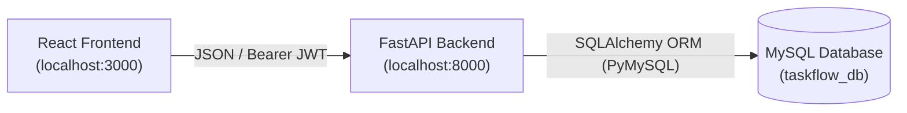

# TaskFlow – Full-Stack Task Management Web Application

TaskFlow is a modern, production-grade task management web application designed to help individuals and teams organize, prioritize, track, and complete their daily tasks with speed and confidence.

---

## 1. Project Overview

* **Application Name:** TaskFlow
* **Architecture:** Three-Tier Architecture (React SPA &rarr; FastAPI REST API &rarr; MySQL Database)
* **Frontend Port:** `http://localhost:3000`
* **Backend Port:** `http://localhost:8000`
* **Swagger API Documentation:** `http://localhost:8000/docs`

---

## 2. Features

* **User Authentication & Authorization:**
  * User Registration with input validation, duplicate email prevention, and client-side password matching.
  * Secure password hashing using **Bcrypt**.
  * User Login with JWT (JSON Web Token) access token generation.
  * Secure token management via Axios interceptors and `localStorage`.
  * User-level data isolation (users can access, update, and delete **only their own** tasks).
* **Task Management (Full CRUD):**
  * Create tasks with Title, Description, Priority (Low, Medium, High), Status (Pending, In Progress, Completed), and Due Date.
  * Edit task details and change statuses in real time.
  * Delete tasks with confirmation modals.
  * Multi-criteria filtering: filter by status, filter by priority.
  * Instant search across task titles and descriptions.
  * Dynamic sorting by Creation Date, Due Date, Title, or Priority (Ascending / Descending).
* **Interactive Dashboard:**
  * 5 Metric cards: Total Tasks, Pending Tasks, In Progress Tasks, Completed Tasks, and Overdue Tasks.
  * Completion rate percentage bar with live calculation.
  * Upcoming Deadlines widget.
  * Recent Tasks activity feed.
  * Quick "New Task" modal action.
* **User Profile & Security:**
  * View account details and registration date.
  * Update full name.
  * Change password with old password verification.
* **Professional UI/UX:**
  * Clean layout built with Bootstrap 5 and customized modern CSS variables.
  * Responsive across desktop, tablet, and mobile devices.
  * Loading indicators, empty-state screens, badges, and modals.

---

## 3. Technology Stack

### Frontend
* **Library:** React.js (v18)
* **Routing:** React Router DOM (v6)
* **Styling:** Bootstrap 5, Bootstrap Icons, Custom CSS
* **HTTP Client:** Axios with interceptors
* **Build Tool:** Create React App (`react-scripts`)

### Backend
* **Language & Runtime:** Python 3.14
* **Framework:** FastAPI
* **Server:** Uvicorn
* **Data Validation:** Pydantic v2
* **Database ORM:** SQLAlchemy 2.0
* **MySQL Driver:** PyMySQL & Cryptography
* **Authentication:** PyJWT & Bcrypt
* **Testing:** Pytest & HTTPX

### Database
* **Database Engine:** MySQL 8.0+
* **Management Tool:** MySQL Workbench / MySQL CLI
* **Database Name:** `taskflow_db`

---

## 4. System Architecture



---

## 5. Project Directory Structure

```text
TaskFlow/
├── frontend/
│   ├── public/
│   │   ├── index.html
│   │   └── manifest.json
│   ├── src/
│   │   ├── assets/
│   │   │   └── styles.css
│   │   ├── components/
│   │   │   ├── ConfirmModal.js
│   │   │   ├── LoadingSpinner.js
│   │   │   ├── Navbar.js
│   │   │   ├── PrivateRoute.js
│   │   │   ├── StatCard.js
│   │   │   ├── TaskCard.js
│   │   │   └── TaskModal.js
│   │   ├── context/
│   │   │   └── AuthContext.js
│   │   ├── pages/
│   │   │   ├── DashboardPage.js
│   │   │   ├── LoginPage.js
│   │   │   ├── NotFoundPage.js
│   │   │   ├── ProfilePage.js
│   │   │   ├── RegisterPage.js
│   │   │   └── TasksPage.js
│   │   ├── services/
│   │   │   ├── api.js
│   │   │   ├── authService.js
│   │   │   └── taskService.js
│   │   ├── utils/
│   │   │   └── formatters.js
│   │   ├── App.js
│   │   └── index.js
│   ├── .env
│   ├── package.json
│   └── vercel.json
│
├── backend/
│   ├── app/
│   │   ├── api/
│   │   │   └── routes/
│   │   │       ├── auth.py
│   │   │       ├── dashboard.py
│   │   │       ├── health.py
│   │   │       ├── tasks.py
│   │   │       └── users.py
│   │   ├── core/
│   │   │   ├── config.py
│   │   │   └── security.py
│   │   ├── database/
│   │   │   ├── base.py
│   │   │   └── session.py
│   │   ├── models/
│   │   │   ├── task.py
│   │   │   └── user.py
│   │   ├── schemas/
│   │   │   ├── dashboard.py
│   │   │   ├── task.py
│   │   │   ├── token.py
│   │   │   └── user.py
│   │   └── utils/
│   │       └── dependencies.py
│   ├── tests/
│   │   ├── conftest.py
│   │   ├── test_auth.py
│   │   ├── test_dashboard.py
│   │   └── test_tasks.py
│   ├── main.py
│   ├── requirements.txt
│   ├── taskflow_init.sql
│   ├── pytest.ini
│   ├── railway.json
│   ├── Procfile
│   ├── .env.example
│   └── .env (git-ignored)
│
├── .gitignore
└── README.md
```

---

## 6. Database Design & Setup

The database schema is defined in [`backend/taskflow_init.sql`](file:///c:/Users/pratik.yadav/Downloads/TaskFlow/backend/taskflow_init.sql).

### Tables:
1. **`users`**:
   * `id` (INT, PK, Auto Increment)
   * `full_name` (VARCHAR(100), NOT NULL)
   * `email` (VARCHAR(120), UNIQUE, NOT NULL, INDEX)
   * `hashed_password` (VARCHAR(255), NOT NULL)
   * `created_at` (DATETIME, DEFAULT CURRENT_TIMESTAMP)
   * `updated_at` (DATETIME, ON UPDATE CURRENT_TIMESTAMP)
2. **`tasks`**:
   * `id` (INT, PK, Auto Increment)
   * `user_id` (INT, FK referencing `users(id)` ON DELETE CASCADE, INDEX)
   * `title` (VARCHAR(200), NOT NULL, INDEX)
   * `description` (TEXT, NULLABLE)
   * `priority` (ENUM('Low', 'Medium', 'High'), DEFAULT 'Medium', INDEX)
   * `status` (ENUM('Pending', 'In Progress', 'Completed'), DEFAULT 'Pending', INDEX)
   * `due_date` (DATE, NULLABLE, INDEX)
   * `created_at` (DATETIME, DEFAULT CURRENT_TIMESTAMP, INDEX)
   * `updated_at` (DATETIME, ON UPDATE CURRENT_TIMESTAMP)

### Setting Up in MySQL Workbench:
1. Open **MySQL Workbench** and connect to your local MySQL instance.
2. Open the file [`backend/taskflow_init.sql`](file:///c:/Users/pratik.yadav/Downloads/TaskFlow/backend/taskflow_init.sql) (**File &rarr; Open SQL Script...**).
3. Click the **Execute (Lightning icon)** button to execute the script.
4. Verify that the `taskflow_db` database and its tables (`users`, `tasks`) appear in the schemas pane.

---

## 7. Prerequisites

* **Node.js** v18+ and **npm**
* **Python** 3.10+ (Python 3.14 included in `backend/venv/`)
* **MySQL Server** 8.0+

---

## 8. Configuration & Environment Variables

### Backend (`backend/.env`)
Edit [`backend/.env`](file:///c:/Users/pratik.yadav/Downloads/TaskFlow/backend/.env) to supply your MySQL credentials:
```env
PROJECT_NAME=TaskFlow
ENV=development
API_V1_STR=/api

SECRET_KEY=taskflow_super_secret_jwt_key_change_in_production_123456789
ALGORITHM=HS256
ACCESS_TOKEN_EXPIRE_MINUTES=1440

MYSQL_HOST=localhost
MYSQL_PORT=3306
MYSQL_USER=root
MYSQL_PASSWORD=your_mysql_password_here
MYSQL_DATABASE=taskflow_db

FRONTEND_URL=http://localhost:3000
```

### Frontend (`frontend/.env`)
Already pre-configured:
```env
PORT=3000
REACT_APP_API_URL=http://localhost:8000/api
BROWSER=none
```

---

## 9. Running the Application (Windows PowerShell)

### Step 1: Start the Backend Server (Port 8000)
Open a PowerShell terminal:
```powershell
cd c:\Users\pratik.yadav\Downloads\TaskFlow\backend
.\venv\Scripts\Activate.ps1
uvicorn main:app --reload --port 8000
```
Backend will be live at **http://localhost:8000**.  
Interactive Swagger docs: **http://localhost:8000/docs**.

### Step 2: Start the Frontend Application (Port 3000)
Open a second PowerShell terminal:
```powershell
cd c:\Users\pratik.yadav\Downloads\TaskFlow\frontend
npm start
```
Frontend will be live at **http://localhost:3000**.

---

## 10. Running Automated Tests

Run the complete backend test suite:
```powershell
cd c:\Users\pratik.yadav\Downloads\TaskFlow\backend
.\venv\Scripts\pytest.exe -v
```
All 18 automated tests verify:
* User registration & email duplicate rejection
* Password mismatch validation
* Login with valid & invalid credentials
* Token generation & `/auth/me` verification
* Password change validation
* Task CRUD operations
* User-level authorization and data isolation
* Dashboard stats calculation and overdue tracking
* Health endpoint check

---

## 11. Deployment Guides

### Frontend &rarr; Vercel
1. Push project to GitHub.
2. In Vercel, click **Add New Project** and select your repository.
3. Set **Root Directory** to `frontend`.
4. Add Environment Variable:
   * `REACT_APP_API_URL` = `https://your-backend-railway-url.up.railway.app/api`
5. Click **Deploy**. Single-page routing is handled by [`frontend/vercel.json`](file:///c:/Users/pratik.yadav/Downloads/TaskFlow/frontend/vercel.json).

### Backend &rarr; Railway
1. In Railway, click **New Project &rarr; Deploy from GitHub repo**.
2. Set Root Directory to `backend`.
3. Add MySQL plugin from Railway dashboard or connect external MySQL.
4. Set Environment Variables in Railway:
   * `MYSQL_HOST`, `MYSQL_PORT`, `MYSQL_USER`, `MYSQL_PASSWORD`, `MYSQL_DATABASE`
   * `SECRET_KEY` = secure random key
   * `FRONTEND_URL` = `https://your-frontend.vercel.app`
5. Railway uses [`backend/railway.json`](file:///c:/Users/pratik.yadav/Downloads/TaskFlow/backend/railway.json) and [`backend/Procfile`](file:///c:/Users/pratik.yadav/Downloads/TaskFlow/backend/Procfile) to start Uvicorn.
